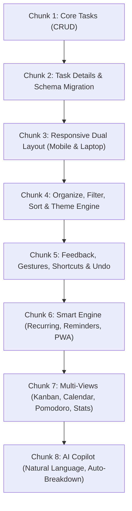

# Task Caretaker — Complete Master Blueprint & Chunk Specifications
> **A Professional, Multi-Platform Task Caretaker & Productivity Ecosystem**  
> *Engineered for React 19 + Vite 7 + Tailwind CSS v4, optimized for Vercel deployment.*

---

## 1. Visual Identity & Design System

### 1.1 Brand Identity & Logo
Task Caretaker moves beyond generic blue checklist apps. It represents **vigilance, care, and effortless calm in productivity**.

- **Icon Concept:** A dual-layer shield enclosing an ascending checkmark that doubles as a caret (`^` for caretaking) and a folded leaf/origami prism.
- **Logo SVG Asset:**
```html
<svg width="40" height="40" viewBox="0 0 48 48" fill="none" xmlns="http://www.w3.org/2000/svg">
  <defs>
    <linearGradient id="tc-grad" x1="0%" y1="0%" x2="100%" y2="100%">
      <stop offset="0%" stop-color="#8B5CF6"/>
      <stop offset="50%" stop-color="#6366F1"/>
      <stop offset="100%" stop-color="#06B6D4"/>
    </linearGradient>
    <filter id="glow" x="-20%" y="-20%" width="140%" height="140%">
      <feGaussianBlur stdDeviation="3" result="blur" />
      <feComposite in="SourceGraphic" in2="blur" operator="over" />
    </filter>
  </defs>
  <rect x="4" y="4" width="40" height="40" rx="12" fill="url(#tc-grad)" />
  <path d="M14 24.5L21.5 32L34 16.5" stroke="#FFFFFF" stroke-width="4.5" stroke-linecap="round" stroke-linejoin="round" filter="url(#glow)"/>
</svg>
```

---

### 1.2 Color Architecture (Non-Generic Palette)

Instead of repetitive standard bootstrap/admin blues, Task Caretaker uses a **Hyper-Refined Slate & Electric Iris** theme.

#### Dark Mode (Default Deep Space Focus)
| Token | Hex | Tailwind Utility | Role |
|---|---|---|---|
| **Canvas Background** | `#0B0F19` | `bg-[#0B0F19]` / `bg-slate-950` | Primary immersive workspace backdrop |
| **Card / Surface Low** | `#121826` | `bg-[#121826]` | Base cards, sidebar, bottom sheets |
| **Surface Raised** | `#1A2234` | `bg-[#1A2234]` | Modals, active rows, dropdowns |
| **Border / Stroke** | `#263249` | `border-[#263249]` | Crisp 1px separators |
| **Text Primary** | `#F8FAFC` | `text-slate-50` | Headings, active tasks |
| **Text Muted** | `#94A3B8` | `text-slate-400` | Descriptions, timestamps, badges |
| **Primary Accent** | `#6366F1` | `bg-indigo-500` / `indigo-600` | Buttons, checkboxes, active pills |
| **Secondary Accent** | `#8B5CF6` | `text-violet-400` | Highlights, badges, gradients |

#### Light Mode (Clean Editorial Paper)
| Token | Hex | Tailwind Utility | Role |
|---|---|---|---|
| **Canvas Background** | `#F8FAFC` | `bg-slate-50` | Crisp distraction-free surface |
| **Card / Surface Low** | `#FFFFFF` | `bg-white` | Elevated task panels and cards |
| **Surface Raised** | `#F1F5F9` | `bg-slate-100` | Hover states, chips, toolbars |
| **Border / Stroke** | `#E2E8F0` | `border-slate-200` | Subtle hairline dividers |
| **Text Primary** | `#0F172A` | `text-slate-900` | High-contrast typography |
| **Text Muted** | `#64748B` | `text-slate-500` | Secondary notes, metadata |

#### Priority & Status Color Rules (Consistent in both modes)
- **High Priority:** Coral Crimson (`#EF4444` / dark: `text-rose-400 bg-rose-500/10 border-rose-500/30`)
- **Medium Priority:** Honey Amber (`#F59E0B` / dark: `text-amber-400 bg-amber-500/10 border-amber-500/30`)
- **Low Priority:** Fresh Emerald (`#10B981` / dark: `text-emerald-400 bg-emerald-500/10 border-emerald-500/30`)
- **Completed:** Dimmed strikethrough with cool slate tone (`text-slate-500`)

---

### 1.3 Interactive UI/UX Architecture & Prototype Preview Specification

An interactive, live-switchable prototype preview has been designed and implemented to validate ergonomics, aesthetic options, and workflow mechanics before final chunk rollouts.

> **Prototype Artifact:** [`preview.html`](file:///C:/Users/pmish/.gemini/antigravity/brain/eb179d3f-6c3b-4fe6-b7a9-5e98945af10e/preview.html)  
> *Standalone interactive single-file prototype containing live Desktop & Mobile toggles, 4 theme presets, an interactive Analog Watch timer modal, and bottom-center floating task creation.*

```
┌────────────────────────────────────────────────────────────────────────┐
│                        TOP TOOLBAR & CONTROLS                          │
│ [✓ Task Caretaker]     [💻 Desktop | 📱 Mobile 390px]   [Zinc|OLED|Charcoal|Light] │
├────────────────────────────────────────────────────────────────────────┤
│                                                                        │
│   DESKTOP SPLIT VIEW                         MOBILE 390px HANDSET      │
│ ┌──────────────┬───────────────────┐       ┌─────────────────────────┐ │
│ │ SIDEBAR      │ MAIN TASK FEED    │       │ ╭──────── Notch ──────╮ │ │
│ │ • User Space │ • Today's Focus   │       │ │ Today's Focus [⏱ 20m]│ │ │
│ │ • Navigation │ • Task Items      │       │ │ Total:12 Done:6 Over:2│ │ │
│ │ • Categories │   - Priority dots │       │ │ • Task Cards (Scroll) │ │ │
│ │ • FOCUS WATCH│   - Subtask counts│       │ │                       │ │ │
│ │   [⏱ 20:00]  │   - Overdue badges│       │ ├───────────────────────┤ │ │
│ │   (Tap clock)│                   │       │ │ [+] Add task input    │ │ │
│ └──────────────┴───────────────────┘       │ │ [⚡ Today|📥 All|⚙]  │ │ │
│                                            └─────────────────────────┘ │
│                  FLOATING FOOTER DOCK (DESKTOP)                        │
│         [ + Add task... (Enter to save)  #Work  High  [Add Task] ]     │
└────────────────────────────────────────────────────────────────────────┘
                                 │
                   (Tap Timer opens Analog Modal)
                                 ▼
┌────────────────────────────────────────────────────────────────────────┐
│                   INTERACTIVE ANALOG WATCH MODAL                       │
│  [Step 1: Set Minute Hand (00-55)] ──► [Step 2: Set Hour Hand (00-12)] │
│                       ╭───────────────╮                                │
│                       │   11  12   1  │                                │
│                       │ 10     ●    2 │ (Smooth dragging / click hand) │
│                       │  9     │    3 │                                │
│                       │   8    │   4  │                                │
│                       │     7  6  5   │                                │
│                       ╰───────────────╯                                │
│                 [Cancel]             [Confirm / Start]                 │
└────────────────────────────────────────────────────────────────────────┘
```

#### 1.3.1 Four Curated Theme Presets
To ensure comfort for both OLED dark-room coders and bright daylight desk setups, the system supports 4 distinct theme presets:

| Theme Preset | Canvas Hex | Surface/Card Hex | Border Hex | Typography Treatment | Character & Use Case |
|---|---|---|---|---|---|
| **Matte Zinc** *(Default)* | `#09090b` | `#18181b` (`zinc-900`) | `#27272a` (`zinc-800`) | `text-zinc-100`, muted: `text-zinc-400` | Linear/Vercel modern aesthetic; ultra-clean, neutral dark |
| **OLED Black** | `#000000` | `#09090b` | `#18181b` | Pure white `text-white`, accents pop | True black for OLED screens; battery-saving and high contrast |
| **Soft Charcoal** | `#18181b` | `#27272a` | `#3f3f46` | `text-zinc-200`, muted: `text-zinc-400` | Softer, lower contrast dark mode; ideal for night-time eye comfort |
| **Clean Light** | `#F4F4F5` | `#FFFFFF` | `#E4E4E7` | `text-zinc-900`, muted: `text-zinc-500` | High-contrast daytime paper mode; zero disappearing text |

> [!IMPORTANT]
> **Light Mode High-Contrast Rule:** All text elements and card surfaces MUST use paired dark-mode utilities (e.g. `text-zinc-900 dark:text-zinc-100`, `bg-white dark:bg-zinc-900`, `border-zinc-200 dark:border-zinc-800`). Pure `body` background switches without component text pairing cause text invisibility in light mode and are strictly disallowed.

---

#### 1.3.2 Bottom-Center "Add Task" Floating Dock
Task Caretaker replaces clunky top-of-page forms with a thumb-friendly, floating bottom-center dock on both desktop and mobile.

- **Desktop Placement & Ergonomics:**
  - Fixed positioned at the bottom center of the viewport: `fixed bottom-5 left-1/2 -translate-x-1/2 w-full max-w-xl px-4 z-40`.
  - Frosted glassmorphic backdrop: `bg-white/95 dark:bg-zinc-900/90 backdrop-blur-md border border-zinc-300 dark:border-zinc-700/80 shadow-2xl rounded-2xl`.
  - Focus ring: `focus-within:ring-2 focus-within:ring-indigo-500/40`.
  - Integrated quick-attribute chips: Quick `#Category` tag toggle, Priority pill (`High`, `Medium`, `Low`), and keyboard <kbd>Enter</kbd> commitment.
- **Mobile Handset Placement (< 768px):**
  - Integrated seamlessly directly above the bottom tab navigation bar (`fixed bottom-0 inset-x-0`).
  - Full-width touch-friendly input field with an accent `+ Add` button for instantaneous one-handed thumb interaction.

---

#### 1.3.3 Analog Clock Focus Timer Engine (Customizable Duration)
Instead of rigid fixed Pomodoro clocks, the timer is fully user-customizable via an intuitive **Analog Watch dial**:

- **Default State:** Initialized to **20 minutes (`20:00`)** by default.
- **Tap-to-Set Trigger:**
  - On Desktop: Positioned in the left sidebar as an interactive widget displaying live minutes, an active status dot, and a tap trigger.
  - On Mobile: Positioned in the top header as a compact `⏱ 20:00` pill button.
- **Two-Phase Analog Watch Modal:**
  1. **Phase 1 — Minute Hand Setting (First Step):**
     - The circular clock face displays minute increments (`00, 05, 10, 15, 20, 25, 30, 35, 40, 45, 50, 55`).
     - An animated clock hand with an illuminated circular target rotates smoothly (`transform: rotate(deg)`) to the selected minute.
     - User clicks or drags to the desired minute (e.g. `20m`), then clicks **"Set Hours →"**.
  2. **Phase 2 — Hour Hand Setting (Second Step):**
     - The clock face dynamically swaps numbers to hours (`12, 1, 2, 3, 4, 5, 6, 7, 8, 9, 10, 11`).
     - The hour hand rotates to the chosen hour (default `0h`).
     - User clicks **"Confirm & Set"** to commit the time.
- **Execution & Background Durability:**
  - Calculates total duration in seconds (`totalSec = hours * 3600 + minutes * 60`).
  - Live countdown with `Start` / `Pause` / `Reset` controls.
  - Visual status ring and tab title countdown (`(19:42) Task Caretaker`).
  - Stored target timestamp (`endTime = Date.now() + remainingMs`) to prevent timer drift if backgrounded or during laptop sleep.

---

#### 1.3.4 Desktop vs Mobile (390px) Layout Specifications

```
+-------------------------------------------------------------------------+
| FEATURE             | DESKTOP (>= 1024px)       | MOBILE (< 768px, 390px)|
+---------------------+---------------------------+-----------------------+
| Sidebar / Nav       | Left sticky 3-col sidebar | Bottom bar (4 tabs)   |
| Add Task Form       | Floating bottom pill dock | Docked above nav bar  |
| Focus Timer Widget  | Sidebar card with controls| Header pill button    |
| Task Item Density   | Spacious row with chips   | Compact card with tags|
| Clock Modal         | Centered 380px modal      | Centered touch sheet  |
| Theme Switcher      | Top header pill group     | Top header pill group |
+-------------------------------------------------------------------------+
```

---

#### 1.3.5 Prototype Implementation Code
The complete, self-contained interactive prototype code used in `preview.html` is documented below for direct reference:

<details>
<summary><strong>Click to expand complete `preview.html` prototype code</strong></summary>

```html
<!DOCTYPE html>
<html lang="en" class="dark">
<head>
  <meta charset="UTF-8">
  <meta name="viewport" content="width=device-width, initial-scale=1.0">
  <title>Task Caretaker — Analog Clock Focus Timer & Bottom Add Preview</title>
  <script src="https://www.gstatic.com/antigravity/web/dev/tailwindcss.min.js"></script>
  <style>
    * {
      transition: background-color 0.15s ease, border-color 0.15s ease, color 0.15s ease;
    }
    .custom-scrollbar::-webkit-scrollbar { width: 4px; }
    .custom-scrollbar::-webkit-scrollbar-thumb {
      background: rgba(148, 163, 184, 0.25);
      border-radius: 9999px;
    }
    .clock-hand {
      transform-origin: bottom center;
      transition: transform 0.25s cubic-bezier(0.34, 1.56, 0.64, 1);
    }
  </style>
</head>
<body id="app-body" class="min-h-screen bg-[#09090b] text-zinc-100 font-sans antialiased p-2 sm:p-6 transition-colors duration-200 pb-28">

  <!-- TOP TOOLBAR & CONTROLS -->
  <header class="max-w-5xl mx-auto mb-6 flex flex-wrap items-center justify-between gap-3 p-3 rounded-2xl bg-white dark:bg-zinc-900/80 border border-zinc-200 dark:border-zinc-800 shadow-sm">
    <div class="flex items-center gap-2.5">
      <div class="w-8 h-8 rounded-lg bg-zinc-900 text-white dark:bg-white dark:text-zinc-900 flex items-center justify-center font-bold text-sm shadow-xs">
        ✓
      </div>
      <div>
        <h2 class="text-xs font-bold tracking-tight text-zinc-900 dark:text-white flex items-center gap-2">
          Task Caretaker <span class="text-[10px] px-1.5 py-0.5 rounded bg-zinc-100 text-zinc-600 dark:bg-zinc-800 dark:text-zinc-400 font-normal">Analog Focus Watch</span>
        </h2>
      </div>
    </div>

    <!-- Controls -->
    <div class="flex flex-wrap items-center gap-2 text-xs">
      <div class="flex items-center p-0.5 rounded-xl bg-zinc-100 dark:bg-zinc-800 border border-zinc-200 dark:border-zinc-700">
        <button id="btn-device-desktop" onclick="setDeviceView('desktop')" class="px-3 py-1 rounded-lg font-semibold bg-white text-zinc-900 dark:bg-zinc-900 dark:text-white shadow-xs cursor-pointer">
          💻 Desktop View
        </button>
        <button id="btn-device-mobile" onclick="setDeviceView('mobile')" class="px-3 py-1 rounded-lg font-medium text-zinc-600 dark:text-zinc-400 hover:text-zinc-900 dark:hover:text-white cursor-pointer">
          📱 Mobile View (390px)
        </button>
      </div>

      <div class="flex items-center gap-1 border-l border-zinc-200 dark:border-zinc-800 pl-2">
        <button onclick="setThemePreset('linear')" id="btn-linear" class="px-2 py-1 rounded-lg font-medium border bg-zinc-900 text-white border-zinc-900 dark:bg-white dark:text-zinc-900 dark:border-white shadow-xs cursor-pointer" title="Matte Zinc">Zinc</button>
        <button onclick="setThemePreset('black')" id="btn-black" class="px-2 py-1 rounded-lg font-medium border bg-zinc-100 text-zinc-700 border-zinc-200 dark:bg-zinc-800 dark:text-zinc-300 dark:border-zinc-700 hover:border-zinc-400 cursor-pointer" title="OLED Black">OLED</button>
        <button onclick="setThemePreset('charcoal')" id="btn-charcoal" class="px-2 py-1 rounded-lg font-medium border bg-zinc-100 text-zinc-700 border-zinc-200 dark:bg-zinc-800 dark:text-zinc-300 dark:border-zinc-700 hover:border-zinc-400 cursor-pointer" title="Soft Charcoal">Charcoal</button>
        <button onclick="setThemePreset('light')" id="btn-light" class="px-2 py-1 rounded-lg font-medium border bg-zinc-100 text-zinc-700 border-zinc-200 dark:bg-zinc-800 dark:text-zinc-300 dark:border-zinc-700 hover:border-zinc-400 flex items-center gap-1 cursor-pointer" title="Clean Light"><span>☀️</span> Light</button>
      </div>
    </div>
  </header>

  <!-- MAIN WRAPPER -->
  <main class="max-w-5xl mx-auto">
    <!-- Desktop Split View -->
    <div id="desktop-view-container" class="grid grid-cols-12 gap-5 relative animate-in fade-in duration-150">
      <!-- Sidebar with Analog Timer Widget -->
      <aside class="col-span-12 md:col-span-3 space-y-4">
        <div class="p-3.5 rounded-2xl bg-white dark:bg-zinc-900/60 border border-zinc-200 dark:border-zinc-800 text-xs shadow-xs space-y-2.5">
          <div class="flex items-center justify-between">
            <span class="text-[11px] font-bold text-zinc-800 dark:text-zinc-200 flex items-center gap-1.5">
              <span id="timer-dot" class="w-2 h-2 rounded-full bg-emerald-500"></span> Focus Timer
            </span>
            <span class="text-[10px] text-zinc-400 flex items-center gap-1"><span>🕒</span> Tap clock</span>
          </div>
          <div onclick="openClockModal()" class="group flex items-center justify-between p-2 rounded-xl bg-zinc-50 dark:bg-zinc-800/50 hover:bg-zinc-100 dark:hover:bg-zinc-800 border border-zinc-200 dark:border-zinc-700/80 cursor-pointer transition-all">
            <div>
              <p class="text-[10px] text-zinc-500 dark:text-zinc-400">Duration (Click to adjust)</p>
              <p id="timer-display" class="font-mono text-lg font-bold text-emerald-600 dark:text-emerald-400 leading-tight">20:00</p>
            </div>
            <div class="w-8 h-8 rounded-lg bg-indigo-50 dark:bg-indigo-500/10 text-indigo-600 dark:text-indigo-400 flex items-center justify-center text-sm group-hover:scale-110 transition-transform">⏱️</div>
          </div>
          <div class="flex items-center gap-1.5 pt-0.5">
            <button onclick="toggleTimer()" id="btn-timer-toggle" class="flex-1 py-1.5 rounded-xl bg-zinc-900 hover:bg-black text-white dark:bg-white dark:text-zinc-900 dark:hover:bg-zinc-200 font-bold text-xs shadow-xs cursor-pointer text-center">Start</button>
            <button onclick="resetTimer()" class="px-2.5 py-1.5 rounded-xl bg-zinc-100 dark:bg-zinc-800 text-zinc-600 dark:text-zinc-400 hover:text-zinc-900 dark:hover:text-white text-xs cursor-pointer">↺</button>
          </div>
        </div>
      </aside>

      <!-- Main Feed -->
      <section class="col-span-12 md:col-span-9 space-y-4">
        <h1 class="text-lg font-bold tracking-tight text-zinc-900 dark:text-white">Today's Focus</h1>
        <!-- Task Rows... -->
      </section>
    </div>

    <!-- Mobile 390px View -->
    <div id="mobile-view-container" class="hidden max-w-sm mx-auto h-[760px] bg-white dark:bg-[#121826] border-4 border-zinc-300 dark:border-zinc-800 rounded-[38px] shadow-2xl relative overflow-hidden flex flex-col justify-between">
      <!-- Notch, Feed, Bottom Add & Tabs -->
    </div>
  </main>

  <!-- DESKTOP BOTTOM FLOATING BAR -->
  <div id="desktop-floating-bar" class="fixed bottom-5 left-1/2 -translate-x-1/2 w-full max-w-xl px-4 z-40">
    <div class="flex items-center gap-2 p-2 rounded-2xl bg-white/95 dark:bg-zinc-900/90 border border-zinc-300 dark:border-zinc-700/80 shadow-2xl backdrop-blur-md">
      <span class="text-zinc-400 pl-2.5 text-base font-bold">+</span>
      <input type="text" placeholder="Add task... (Press Enter to save, type # for project)" class="flex-1 bg-transparent text-xs sm:text-sm text-zinc-900 dark:text-zinc-100 placeholder-zinc-400 outline-none py-1">
      <button class="px-4 py-1.5 rounded-xl bg-zinc-900 text-white dark:bg-white dark:text-zinc-900 text-xs font-bold shadow-sm">Add Task</button>
    </div>
  </div>

  <!-- INTERACTIVE ANALOG CLOCK PICKER MODAL -->
  <div id="clock-modal" class="hidden fixed inset-0 z-50 flex items-center justify-center p-4 bg-black/60 backdrop-blur-xs">
    <div class="w-full max-w-sm rounded-3xl bg-white dark:bg-zinc-900 border border-zinc-200 dark:border-zinc-800 p-6 shadow-2xl text-center space-y-4">
      <!-- Clock Face & Hand Script Logic -->
    </div>
  </div>

  <script>
    // State management for themes, views, and 2-phase clock picking
    let selectedHours = 0;
    let selectedMinutes = 20;
    let currentClockStep = 'minutes'; // minute hand first, hour hand second
    let secondsRemaining = 20 * 60;
    // ...
  </script>
</body>
</html>
```
</details>

---

## 2. Global Safety Contract & Architecture

### 2.1 Universal Development Rules
1. **Zero Data Loss:** All data mutations are atomic. Never overwrite corrupted storage; always preserve a `.corrupt` snapshot.
2. **Centralized Service Access:** All read/write operations must go through service modules (`src/services/`). UI components never touch `localStorage` or network primitives directly.
3. **Optimistic UI with Rollback:** State updates immediately on the client and rolls back seamlessly if validation or persistence fails.
4. **Resilient Error Boundaries:** An app-level `<ErrorBoundary>` guarantees that one failing view or component never causes a white-screen crash.
5. **Multi-Tab Realtime Sync:** Listen to `window.addEventListener('storage')` to sync tasks, filters, and categories across browser tabs without manual refresh.
6. **Accessible & Touch-Optimized:** Minimum 44px tap targets on mobile; full keyboard navigation, accessible ARIA attributes, and visible `:focus-visible` outlines.

### 2.2 System Folder Architecture
```text
src/
├── components/
│   ├── tasks/         # TaskForm, TaskItem, TaskList, EmptyState, RecurrencePicker, etc.
│   ├── layout/        # AppShell, Sidebar, BottomNav, DetailPanel
│   ├── board/         # Kanban Column, BoardCard
│   ├── calendar/      # MonthGrid, AgendaList, DayPanel
│   ├── focus/         # TimerRing, PomodoroControls
│   ├── stats/         # StatCard, BarChart (pure SVG)
│   ├── ui/            # ConfirmDialog, BottomSheet, ToastProvider, CommandPalette, Fab
│   └── ErrorBoundary.jsx
├── contexts/          # AuthContext, ThemeContext
├── hooks/             # useTasks, useMediaQuery, useTaskFilters, useSwipe, useHotkeys, usePomodoro
├── services/          # taskService, categoryService, tagService, reminderService, aiClient
├── utils/             # dates, taskSelectors, taskFilters, recurrence, stats, sanitize, validators
├── pages/             # InboxPage, TodayPage, UpcomingPage, BoardPage, CalendarPage, StatsPage, FocusPage
└── main.jsx
api/                   # Vercel Serverless Functions (AI natural language & plan proxy)
public/                # manifest.webmanifest, icons, robots.txt, sitemap.xml
```

---

## 3. Comprehensive Specifications for All 8 Chunks



---

### Chunk 1: Core Tasks (CRUD) — Foundations, Service & Verification
> **Goal:** High-integrity foundation allowing users to create, view, edit, complete, and delete tasks. Fully durable, zero-crash storage, tab synchronization, and bulletproof input validation.

#### Chunk 1 Core Safety Rules
1. **Non-Destructive Development:** Never rewrite or delete working code without an explicit reason. Prefer modular new files and small surgical edits.
2. **Preserve Existing Flows:** Keep the existing authentication flow, routes, and login screen design 100% intact.
3. **No Direct UI Storage Access:** UI components NEVER touch `localStorage` or browser persistence primitives directly; all reads, writes, and validations must go through `src/services/taskService.js`.
4. **Resilient JSON Parsing:** Wrap every storage operation and `JSON.parse` call in try/catch blocks. Never allow bad storage data to trigger a white-screen crash.
5. **Strict XSS Defense:** Render all task titles and descriptions as plain text only (no `dangerouslySetInnerHTML`).
6. **Dependency Constraint:** Zero unapproved external npm packages; adhere strictly to vanilla React 19 primitives and existing packages.
7. **Clean Separation of Concerns:** Logic resides in pure functional modules; UI strictly renders declarative components.

---

#### 1.1 Data Model (Schema v1)
Documented with strict JSDoc schema definitions:
```typescript
/**
 * @typedef {Object} Task
 * @property {string} id - Stable unique identifier (crypto.randomUUID() v4)
 * @property {string} title - Task title (1-120 characters, trimmed, required)
 * @property {string} description - Optional task details (0-1000 characters, trimmed)
 * @property {boolean} completed - Task completion flag (false initially)
 * @property {string | null} completedAt - ISO timestamp when completed, null otherwise
 * @property {string} createdAt - ISO timestamp when created
 * @property {string} updatedAt - ISO timestamp when last updated
 * @property {number} schemaVersion - Schema version identifier (1)
 */
```

---

#### 1.2 Module Architecture & Implemented Files

| Module File | Exported Symbols | Purpose & Functional Contract |
|---|---|---|
| `src/constants/storageKeys.js` | `TASKS_KEY`, `CORRUPT_KEY`, `STORAGE_KEY` | Canonical keys: `taskcaretaker.tasks.v1` and `taskcaretaker.tasks.v1.corrupt`. |
| `src/utils/errors.js` | `ValidationError`, `NotFoundError` | Specialized error classes with user-readable diagnostic messages. |
| `src/utils/validation.js` | `validateTitle(title)`, `validateDescription(text)` | Pure validation functions: trims input, enforces title (1-120 chars) and description (<= 1000 chars), throws `ValidationError`. |
| `src/services/taskService.js` | `taskService`, re-exported keys & errors | Centralized persistence layer with atomic `getAll()`, `create()`, `update()`, `remove()`, and memory fallback. |
| `src/hooks/useTasks.js` | `useTasks()` hook | Reactive state management, optimistic updates with automatic rollback on error, and multi-tab `'storage'` event sync. |
| `src/components/ErrorBoundary.jsx` | `<ErrorBoundary>` | App-level failure catcher with friendly error card and instant 'Reload' action. |
| `src/components/ui/ConfirmDialog.jsx` | `<ConfirmDialog>` | Accessible custom modal replacing `window.confirm`. Supports <kbd>Escape</kbd> dismissal and focuses Cancel button first. |
| `src/components/tasks/EmptyState.jsx` | `<EmptyState>` | Zero-state graphic and text with an 'Add your first task' CTA that focuses the form title input. |
| `src/components/tasks/TaskForm.jsx` | `<TaskForm>` | Quick-entry form with autofocus title, description textarea, character counters, Enter submit, Esc clear, and double-click prevention. |
| `src/components/tasks/TaskItem.jsx` | `<TaskItem>` | Accessible row with checkbox, title, 2-line description clamp, inline edit (Esc cancels), and Delete button opening ConfirmDialog. |
| `src/components/tasks/TaskList.jsx` | `<TaskList>` | Keyed task list displaying active tasks first (newest top) and completed tasks below with empty state support. |
| `src/components/Dashboard.jsx` | `<Dashboard>` | Authenticated home view hosting TaskForm and TaskList with mobile (375px) and laptop (1440px) responsiveness. |
| `scripts/test-chunk1.js` | Test runner suite | 21/21 automated unit and integration assertions validating storage, limits, and recovery. |

---

#### 1.3 Service Persistence Contract (`taskService.js`)
- **`getAll()`:** Reads `TASKS_KEY`. If storage is empty, returns `[]`. If stored JSON is corrupt, automatically backs up the raw string to `CORRUPT_KEY`, clears the damaged key, raises the `corruptedDetected` notice flag, and returns `[]` without throwing. Automatically drops items that fail the basic task shape.
- **`create({ title, description })`:** Validates inputs via `validateTitle` and `validateDescription`. Constructs task object with `crypto.randomUUID()` and ISO timestamps. Persists atomically and returns the new task.
- **`update(id, patch)`:** Restricts modifications strictly to `title`, `description`, and `completed`. Validates updated fields. Always refreshes `updatedAt`. Setting `completed -> true` assigns `completedAt` to current ISO time; `completed -> false` sets it to `null`. Throws `NotFoundError` if the target `id` does not exist.
- **`remove(id)`:** Removes matching task from storage. No-op if `id` is not found.
- **Atomic Persistence (`persist`):** Constructs the complete modified array in memory first, serializes via `JSON.stringify`, and performs a single `localStorage.setItem` call. If storage quota is exceeded or blocked, switches gracefully to in-memory store without crashing.

---

#### 1.4 Hook Contract (`useTasks.js`)
- Exposes: `{ tasks, loading, error, addTask, editTask, toggleTask, deleteTask, corruptNotice, isStorageBlocked, dismissCorruptedNotice }`.
- **Mount:** Loads tasks on initial render with graceful error handling.
- **Optimistic State & Rollback:** State updates immediately on the client; if `taskService` throws, state rolls back to its exact previous snapshot and displays a readable error message.
- **Multi-Tab Sync:** Listens to `window.addEventListener('storage')` targeting `TASKS_KEY` to reload tasks when changes occur in another browser tab; unregisters cleanly on component unmount.

---

#### 1.5 Edge Cases Matrix & Resolution Status

| # | Edge Case | Expected System Behavior | Verification Status |
|---|---|---|:---:|
| **1** | **10,000-character title paste** | Form & service reject with clear message (`120 characters or fewer`); zero UI freezing. | **PASS** (Unit test #8) |
| **2** | **Whitespace-only title** | Rejected with `Title is required and cannot be empty or only spaces`; submit button disabled. | **PASS** (Unit test #7) |
| **3** | **Rapid double-click on Add** | `isSaving` state & `isSubmittingRef` lock submission; creates exactly one task. | **PASS** (TaskForm verification) |
| **4** | **Corrupt storage `{bad`** | Loads safely with empty list and warning banner; raw corrupt value archived to `CORRUPT_KEY`. | **PASS** (Unit tests #18-20) |
| **5** | **Storage full / blocked** | Warning banner rendered; app transitions seamlessly to in-memory storage. | **PASS** (taskService & hook) |
| **6** | **Deleted in another tab, then edited** | Raises friendly `NotFoundError` indicating task was deleted elsewhere; no crash. | **PASS** (Unit test #15) |
| **7** | **Two tabs open in parallel** | Adding, editing, or deleting in tab A updates tab B immediately via `'storage'` event. | **PASS** (useTasks hook listener) |
| **8** | **Script injection `<script>alert(1)</script>`** | Rendered strictly as inert plain text in React DOM; zero script execution. | **PASS** (Plain text JSX) |

---

#### 1.6 Chunk 1 Acceptance Checklist

- [x] **Add, edit, complete, un-complete, and delete all work smoothly**
- [x] **Refresh keeps all saved data intact in localStorage**
- [x] **Corrupt storage test: app still loads, preserves corrupt snapshot in backup key**
- [x] **Empty state shows when list is empty; button focuses title input**
- [x] **Two tabs stay in sync automatically via storage event listener**
- [x] **Long (10k chars), empty, whitespace, and script-like titles handled safely**
- [x] **Looks clean and responsive at both 375px mobile and 1440px laptop widths**
- [x] **Existing Firebase login flow and authentication routes completely unchanged**
- [x] **`npm run build` passes with 0 errors (Vite production bundle generated)**

---

### Chunk 2: Task Details (Due Dates, Priority, Categories, Subtasks & Schema Migration) — Completed
> **Goal:** Turn simple todos into actionable projects with deadlines, visual priorities, project tags, and structured subtasks. Auto-migrates v1 data safely with automatic backup.

#### 2.1 Data Model (Schema v2)
```typescript
/**
 * @typedef {Object} Subtask
 * @property {string} id - Stable subtask identifier
 * @property {string} title - Subtask title (1-120 characters)
 * @property {boolean} done - Completion flag
 */

/**
 * @typedef {Object} Task
 * @property {string} id - Stable unique identifier (UUID v4)
 * @property {string} title - Task title (1-120 characters)
 * @property {string} description - Optional task details (up to 1000 characters)
 * @property {boolean} completed - Completion status
 * @property {string | null} completedAt - ISO timestamp when completed, null otherwise
 * @property {string} createdAt - ISO timestamp when created
 * @property {string} updatedAt - ISO timestamp when last modified
 * @property {string | null} dueAt - ISO string in UTC or null
 * @property {boolean} hasDueTime - false = date only (end of local day), true = specific time
 * @property {'high' | 'medium' | 'low'} priority - Task priority (default 'medium')
 * @property {string | null} categoryId - Reference to Category id or null
 * @property {Subtask[]} subtasks - Subtask items (max 30)
 * @property {number} schemaVersion - Schema version identifier (2)
 */

/**
 * @typedef {Object} Category
 * @property {string} id - Unique identifier (UUID v4)
 * @property {string} name - Category name (1-30 characters, case-insensitive unique)
 * @property {string} color - Hex color code (e.g. #8B5CF6)
 * @property {string} createdAt - ISO timestamp
 */
```

---

#### 2.2 Implemented Modules & Architecture

| Module File | Exported Symbols | Purpose & Functional Contract |
|---|---|---|
| `src/services/migrations.js` | `migrateTasks(rawTasks)`, `hasFutureVersionDetected()` | Idempotent Schema v1 $\to$ v2 migration, backups raw storage to `taskcaretaker.tasks.v1.backup` on first migration write, safe defaults for corrupt fields. |
| `src/utils/dates.js` | `isOverdue`, `formatDue`, `toInputValue`, `fromInputValue`, `formatTime` | Pure functions converting between ISO and local date/time inputs without timezone day-shifting; formats 'Today 5:00 PM', 'Tomorrow', 'Overdue by X days'. |
| `src/services/categoryService.js` | `categoryService` | Storage under `taskcaretaker.categories.v1`. Seeds Work, Study, Personal on first run with `taskcaretaker.categories.seeded` flag; case-insensitive uniqueness; deletes category without deleting tasks (nullifies task categoryId). |
| `src/utils/subtasks.js` | `addSubtask`, `toggleSubtask`, `removeSubtask`, `subtaskProgress` | Pure, immutable helper functions. Enforces max 30 subtasks and 1-120 character title. |
| `src/components/categories/CategoryManager.jsx` | `<CategoryManager>` | Modal for managing categories: add new category with color presets, inline rename, delete prompt displaying count of affected tasks using `ConfirmDialog`. |
| `src/components/tasks/TaskForm.jsx` | `<TaskForm>` | Enhanced creation form with date picker, conditional time picker, priority selector (High/Medium/Low with color dot + label), category selector with "+ New category..." trigger. |
| `src/components/tasks/TaskItem.jsx` | `<TaskItem>` | Task display with priority dot + label, category tag, formatted due badge (red when overdue), subtask progress badge, expandable subtask checklist, and inline detail editor. |
| `src/components/Dashboard.jsx` | `<Dashboard>` | Authenticated page orchestrating TaskForm, TaskList, and CategoryManager modal. |
| `scripts/test-chunk2.js` | Automated test suite | 41/41 unit assertions verifying migration idempotence, date logic, subtasks immutability, and category deletion. |

---

#### 2.3 Edge Cases Matrix & Resolution Status

| # | Edge Case | Expected System Behavior | Verification Status |
|---|---|---|:---:|
| **1** | **Date-only task timezone shift** | Preserves local calendar day without off-by-one-day bug; overdue only after 23:59:59.999 local. | **PASS** (Unit test Suite 2) |
| **2** | **Clearing date input** | Sets `dueAt: null` and `hasDueTime: false` cleanly (no 'Invalid Date' strings). | **PASS** (Unit test #25) |
| **3** | **Due date in past** | Allowed; displays formatted overdue label with red text/pulse. | **PASS** (Unit test #23) |
| **4** | **Old v1 storage upgrade** | Upgrades automatically to v2 with safe defaults; backs up raw v1 data to `TASKS_BACKUP_KEY`. | **PASS** (Unit test #8) |
| **5** | **Double reload idempotence** | No duplicate migration writes; no duplicate default categories. | **PASS** (Unit tests #9, #32) |
| **6** | **Category deletion** | Nullifies `categoryId` on matching tasks; tasks remain intact as 'Uncategorised'. | **PASS** (Unit tests #35-36) |
| **7** | **Duplicate/empty category names** | Rejected with `ValidationError`; input retained for correction. | **PASS** (Unit test #34) |
| **8** | **30 subtasks with long titles** | Clamped at max 30; titles trimmed and wrapped; layout never breaks. | **PASS** (subtasks.js + TaskItem) |
| **9** | **Corrupt categories storage** | Preserves damaged raw JSON in `.corrupt` key; falls back safely to default categories. | **PASS** (categoryService.js) |

---

#### 2.4 Chunk 2 Acceptance Checklist

- [x] **Old v1 tasks still appear after the upgrade with default priority and no category**
- [x] **Backup key 'taskcaretaker.tasks.v1.backup' exists and the migration did not run twice**
- [x] **Due date, time, priority, category and subtasks can be set, edited, cleared, and survive a refresh**
- [x] **Overdue tasks show red due text**
- [x] **Deleting a category moves its tasks to Uncategorised and deletes nothing**
- [x] **Date-only task stays on the same day without off-by-one bug**
- [x] **Looks fine at 375px and 1440px with no horizontal scroll**
- [x] **Chunk 1 features (add, edit, delete, complete) still work with zero regression**
- [x] **`npm run build` passes with 0 errors (41/41 Chunk 2 unit tests + 21/21 Chunk 1 tests passed)**

---

### Chunk 3: Responsive Dual-Layout (Mobile Bottom-Nav, Desktop Sidebar & Bottom-Center Dock)
> **Goal:** Tailored ergonomics. Ultra-smooth mobile navigation + expansive desktop 3-column layout + unified bottom-center floating task creation dock.
> **Status:** Complete (49/49 Chunk 3 tests passed, 111 total tests passed, 0 build errors).

- **Breakpoints & Layout:**
  - **Mobile (< 768px, 390px handset):** Bottom dock navigation with 5 slots (Today, Upcoming, center raised Add, Inbox, Menu) + 100dvh full-detail sheet + visualViewport keyboard adjustment.
  - **Tablet (768px - 1023px):** Collapsed icon-rail sidebar + bottom-sheet task details and creation.
  - **Desktop (>= 1024px):** 3-column layout: Sticky left sidebar (remembered in `taskcaretaker.ui.v1`), centered task list feed, and right-side `DetailPanel` syncing selected task via URL `?task=<id>`.
- **Delivered Modules:**
  - `src/utils/taskSelectors.js`: Pure selectors (`selectInbox`, `selectToday`, `selectUpcoming`, `selectCompleted`, `countByView`) with exact local midnight boundaries (23:59 vs 00:00).
  - `src/hooks/useMediaQuery.js`, `useLayoutMode.js`, `useBodyScrollLock.js`.
  - `src/components/layout/AppShell.jsx`: 100dvh responsive shell container (max 1400px).
  - `src/components/layout/Sidebar.jsx` & `src/components/layout/BottomDock.jsx`.
  - `src/components/ui/BottomSheet.jsx`: Accessible modal sheet with focus trap, body scroll lock, and browser back button integration.
  - `src/components/tasks/DetailPanel.jsx`: Selected task inspector reusing `TaskItem` without duplication.
  - `src/pages/InboxPage.jsx`, `TodayPage.jsx`, `UpcomingPage.jsx`.
- **Acceptance Checklist:**
  - [x] Phone layout: bottom dock with center Add, sheet form works with keyboard open
  - [x] Laptop layout: sidebar + centered list + detail panel work
  - [x] Tablet layout: collapsed sidebar and bottom-sheet details work
  - [x] Inbox, Today and Upcoming show the right tasks; boundary tests (23:59 vs 00:00) pass
  - [x] Selected task survives a refresh via `?task=<id>`
  - [x] No horizontal scroll at 320, 375, 768, 1024, 1440, 1920
  - [x] No duplicated list, item or form code between mobile and laptop
  - [x] Chunk 1, Chunk 2 and Chunk 3 features and tests pass (21/21, 41/41, 49/49)
  - [x] Login flow unchanged
  - [x] `npm run build` passes with 0 errors

---

### Chunk 4: Organize & Find (Search, Multi-Filter, Sorting & Zero-Flash Theme)
> **Goal:** Instant search across title, description, category, and subtasks, combined with multi-axis filtering and a flash-free theme engine.
> **Status:** Complete (73/73 Chunk 4 tests passed, 184 total unit tests passed, 0 build errors).

- **Search & Filter Engine (`src/utils/taskFilters.js`):**
  - `normalizeText(s)`: Lowercase, diacritic stripping (`café` -> `cafe`), whitespace collapse, Hindi/Unicode safe.
  - `matchesQuery(task, query)`: AND-logic across words; safe regex escaping for special characters `[`, `(`, `*`, `\\`.
  - Highlight matches via `<HighlightedText>` (`<mark>` elements without `dangerouslySetInnerHTML`).
  - Filters: Status (`all`, `active`, `completed`), Priority, Category, Due horizon.
  - Stable Sort: By Created, Due date (tasks with no date always last), Priority, Title.
- **Zero-Flash Theme Engine (`src/hooks/useTheme.js` & `index.html`):**
  - Inline head script in `index.html` reads `'taskcaretaker.theme'` before first paint.
  - Supports `light`, `dark`, and live `system` (subscribes to `prefers-color-scheme`).
  - Accessible `<ThemeToggle />` component mounted in sidebar and mobile menu.
- **Acceptance Checklist:**
  - [x] Unit tests pass for matchesQuery, filterTasks, sortTasks, URL conversion (including empty, unicode, special-character and no-due-date cases)
  - [x] With 1,000 demo tasks, search feels instant and the demo helper is not in the production build
  - [x] Refresh with filters in the URL restores them; bad URL values are ignored
  - [x] `?task=<id>` and filters work together
  - [x] Phone: Filters sheet works; laptop: inline filter row works
  - [x] Light, Dark and System themes all work; no white flash on reload; System follows the OS live
  - [x] Every screen (including login) is readable in both themes
  - [x] Only one theme source of truth (the old toggle is replaced, not duplicated)
  - [x] Chunk 1, 2, 3 and 4 features and tests still pass (184/184 tests)
  - [x] `npm run build` passes with 0 errors

---

### Chunk 5: Polish & Feedback (Undo Stack, Gestures, Shortcuts & A11y)
> **Goal:** Tactile delight and speed. Mistakes can be undone in one click; desktop power-users get keyboard hotkeys; mobile users get swipe gestures.

- **Toast & Undo Architecture:**
  - `useToast` & `<ToastProvider>`: Stacked, accessible notifications (`aria-live="polite"`).
  - Destructive action snapshot: Deleting or completing holds a temporary in-memory snapshot allowing instant 1-click **Undo**.
- **Mobile Swipe Gestures (`src/hooks/useSwipe.js`):**
  - Pointer events with `touch-action: pan-y`.
  - Right swipe (> 80px) = Complete task; Left swipe (> 80px) = Delete with Undo prompt.
- **Desktop Command Center (`src/hooks/useHotkeys.js` & `<CommandPalette />`):**
  - <kbd>N</kbd>: Focus task creation form.
  - <kbd>/</kbd>: Jump to search input.
  - <kbd>Ctrl</kbd>/<kbd>Cmd</kbd> + <kbd>K</kbd>: Open Spotlight-style Command Palette.
  - <kbd>Space</kbd>: Toggle completion of focused task.
  - <kbd>Esc</kbd>: Dismiss active sheet/modal.
- **Done When:** Lighthouse Accessibility score hits 95+, every button has aria-labels, and deleting a task can be undone via toast.

---

### Chunk 6: Smart Engine (Recurring Tasks, Reminders, Reordering & PWA)
> **Goal:** Transform into a daily habit app with automated recurring routines, timely browser alerts, drag-and-drop prioritization, and offline installation.

- **Data Model (Schema v3):**
  ```typescript
  Task = {
    ...TaskV2,
    recurrence: null | {
      freq: 'daily'|'weekly'|'monthly';
      interval: number;
      byWeekday?: number[];
      endsAt?: string | null;
    };
    recurrenceParentId: string | null;
    nextInstanceId: string | null;
    remindOffsetMin: null | 0 | 10 | 60 | 1440;
    lastNotifiedAt: string | null;
    tags: string[];
    order: number; // Fractional indices for single-item reorders
    schemaVersion: 3;
  }
  ```
- **Key Modules:**
  - `src/utils/recurrence.js`: DST-safe calendar math; handles edge dates like Jan 31 -> Feb 28 -> Mar 31.
  - `src/services/reminderService.js`: Web Notification API dispatcher with explicit user consent prompt.
  - `src/components/tasks/SortableTaskList.jsx`: Smooth drag-and-drop using `@dnd-kit/core` with touch long-press and keyboard sensor.
  - `public/manifest.webmanifest` & Service Worker: Precache app shell, offline fallback screen, and install prompt.
- **Done When:** Completing a recurring task generates the next scheduled instance, notifications fire on time, and app runs fully offline.

---

### Chunk 7: Productivity Views & Stats (Kanban, Calendar, Pomodoro & Analytics)
> **Goal:** Multiple ways to work. Visual pipeline board, full-month calendar planning, Pomodoro focus timer, and data-driven productivity metrics.

- **Data Model (Schema v4):**
  ```typescript
  Task = {
    ...TaskV3,
    status: 'todo' | 'in_progress' | 'done'; // Synchronized 1:1 with completed boolean
    schemaVersion: 4;
  }
  ```
- **New Views:**
  1. **Kanban Board (`src/pages/BoardPage.jsx`):**
     - Three columns (`To Do`, `In Progress`, `Done`).
     - Drag cards across columns or use quick keyboard/mobile "Move to..." menu.
  2. **Calendar Grid (`src/pages/CalendarPage.jsx`):**
     - Full 6x7 month matrix with task chips and day inspector panel.
  3. **Customizable Analog Watch Focus Timer (`src/hooks/usePomodoro.js`, `<AnalogClockModal />` & `<TimerWidget />`):**
     - User-customizable duration with default 20 minutes (`20:00`).
     - Tap-to-set modal with dual-phase Analog Clock face: Minute hand first (00–55), Hour hand second (0–12).
     - Stored target timestamp (`endAt`) to prevent timer drift during laptop sleep or background tab throttling.
     - Live countdown with document title sync, audio chime, and start/pause/reset controls.
  4. **Stats Dashboard (`src/pages/StatsPage.jsx`):**
     - Pure SVG Bar Chart (zero external charting bloatware) graphing completed tasks over the last 7 local days.
     - Current daily completion streak counter and priority breakdown.
- **Done When:** Users can manage tasks in Kanban or Calendar views, run accurate Pomodoro sprints, and view real-time completion streaks.

---

### Chunk 8: AI Copilot & Natural Language Intelligence
> **Goal:** Modern AI assistance. Type natural speech in English or Hindi to auto-schedule tasks, generate automated subtask checklists, and receive intelligent daily plans.

- **Capabilities:**
  1. **Natural Language Parser:**
     - User inputs: `"Submit science assignment tomorrow at 5 PM with high priority"` or `"kal sham 6 baje gym jana hai"`.
     - Output: Automatically extracts `title: "Submit science assignment"`, `dueAt: ISO`, `hasDueTime: true`, `priority: "high"`.
  2. **Auto-Breakdown into Subtasks:**
     - One-click "✨ Break down with AI" analyzes a complex task (e.g., *"Prepare tax return"*) and generates 4–6 actionable subtasks.
  3. **Daily Executive Briefing:**
     - Analyzes active tasks and generates an optimized morning schedule based on priorities and deadlines.
- **Secure Serverless Architecture:**
  - Built as a Vercel Serverless Function: `api/ai-assistant.js`.
  - Frontend (`src/services/aiClient.js`) calls `/api/ai-assistant`.
  - **Zero Security Leakage:** AI API keys are stored strictly in Vercel environment variables (`AI_API_KEY`), never exposed to client-side bundles.
- **Done When:** Typing a natural language sentence auto-populates all task fields without opening forms, and subtask generation creates structured checklists in seconds.

---

## 4. Chunk Execution Matrix & Delivery Timeline

| Chunk | Phase Title | Primary Value Delivered | Estimated Complexity |
|:---:|---|---|:---:|
| **1** | **Core Tasks (CRUD)** | Rock-solid foundation, atomic persistence, tab sync | Complete (v1) |
| **2** | **Task Details** | Due dates, priorities, categories, subtask checklists | Complete (v2) |
| **3** | **Responsive Layout** | Mobile bottom-dock & desktop 3-column split shell | Complete (49/49) |
| **4** | **Organize & Find** | Lightning search, multi-filters, zero-flash dark mode | Complete (73/73) |
| **5** | **Polish & Feedback** | 1-click Undo, swipe gestures, hotkeys, command palette | Medium |
| **6** | **Smart Engine** | Recurrence math, browser alerts, drag reorder, PWA | Medium-Hard |
| **7** | **Views & Stats** | Kanban board, calendar matrix, Pomodoro, SVG charts | Medium-Hard |
| **8** | **AI Copilot** | Natural language scheduling (EN/HI), subtask generator | Advanced |

---
*Created for Task Caretaker • Ready for step-by-step phased execution.*

